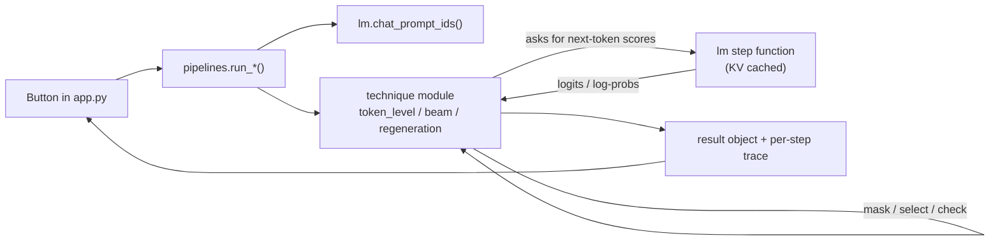

# Logits Masking Explorer

An interactive Streamlit app for **seeing** how logits masking steers a language model: token by
token, beam by beam, and segment by segment. It runs a small open model (Qwen2.5) on your laptop,
so you can inspect every probability and every decision instead of just reading about them.

It's a companion to the *Logits Masking* examples in
[Generative AI Design Patterns](https://github.com/lakshmanok/generative-ai-design-patterns)
(`examples/01_logits_masking`), and covers notebooks 0 to 3.

> **New to this?** Read [docs/how-logits-masking-works.md](docs/how-logits-masking-works.md) first.
> It explains the ideas in plain language with diagrams and real examples from this app.
> Terms are defined in [GLOSSARY.md](GLOSSARY.md).

---

## Quick start

Requirements: [uv](https://docs.astral.sh/uv/), about 2 GB of free RAM, and an internet connection
for the first run (to download the model, about 1 GB).

```bash
uv sync                          # installs Python 3.12 + dependencies into .venv
uv run streamlit run app.py      # opens http://localhost:8501
```

The first click in any tab loads the model (around 10 to 20 seconds). After that, each run takes
roughly 2 to 50 seconds on a laptop CPU, depending on the tab and settings.

Run the tests:

```bash
uv run pytest
```

### Configuration

| Setting | How | Default |
|---|---|---|
| Model | Sidebar dropdown | `Qwen/Qwen2.5-0.5B-Instruct` (also offers `1.5B`, which writes better but is ~3x slower) |
| Device | `LME_DEVICE=mps uv run streamlit run app.py` (or `cuda`) | `cpu` (or `cuda` if available) |

> **Why not Apple's MPS by default?** Recent PyTorch builds crash on MPS on older macOS versions
> (seen on macOS 14). The 0.5B model is fast enough on CPU. On macOS 15+ you can try `LME_DEVICE=mps`.

---

## How the app works

The app has four tabs, meant to be followed in order. Each one adds one idea on top of the last.

### ① Token-level masking

**What it shows:** how pushing specific tokens' logits to −∞ changes what the model writes.

**You provide:** a product name (default "protein drink"), a list of banned phrases (default: 412
phrases Amazon restricts in listings), and a maximum length.

**What happens when you click *Generate both runs*:**

1. The prompt (the notebook's product-marketer prompt) is formatted with Qwen's chat template.
2. Every banned phrase is expanded into spelling variants (lowercase, Capitalised, Title Case,
   UPPER, each with and without a leading space), and each variant is tokenized.
   These token sequences go into an index keyed by everything except the last token
   (`TokenBanList` in `logits_lab/masking.py`).
3. The model generates **twice** with greedy decoding (always the top token):
   - **without mask:** the model's natural output;
   - **with mask:** at every step, the last tokens generated are checked against the index, and any
     token that would *complete* a banned sequence gets logit −∞.
4. At every step of the masked run, the app records the top 10 tokens **before** and **after** the
   mask.

**What you see:**

- Both outputs side by side, each listing the banned phrases it contains.
- The steps where the mask changed the model's top choice.
- A step slider showing the "before" table (banned tokens marked 🚫) and the renormalised "after"
  table. Start at the first step the mask changed; you'll see the model's favourite vanish and the
  probability move to the alternatives.
- *How the banned phrases tokenize*: a searchable table showing each phrase's variants split into
  tokens (e.g. `Ultimate` → `Ult | imate`), which is why masking has to be prefix-aware.

### ② Sequence selection

**What it shows:** masking whole beams (drafts) by a score, as notebooks 0 and 1 do.

**You provide:** a scorer, a subject, the number of beams (default 4), and a maximum length.

| Scorer | Prompt | Score |
|---|---|---|
| **Brand score** (notebook 0) | Product description | desired phrases present − banned phrases present (both lists editable) |
| **Alliteration score** (notebook 1) | Nursery rhyme about an animal | words starting with the animal's first letter |

**What happens when you click *Run*:** two beam searches run with the same settings
(`logits_lab/beam.py`):

1. **Plain beam search:** no masking (`keep_all` selector).
2. **With sequence selection:** at every step, each beam's text so far is scored. Beams tied for
   the best score survive; every other beam's whole row of log-probabilities is replaced by
   `-10000` (the notebooks' value). The best `num_beams` (beam, next token) pairs by total
   log-probability become the next beams, so they all descend from survivors.

**What you see:** both final outputs with their scores, a chart of how many beams survived at each
step, and a step slider with two tables:

- **Beams at step N:** every beam's text, total log-probability, score, and status
  (✅ survives / 🚫 masked).
- **Candidates for step N+1:** every (beam, next token) pair that competed for the next round,
  ranked by `total = parent total + log p(token)`. It shows the token's real probability
  (even for masked beams, so you can see what the mask threw away) and whether the candidate
  became a beam, was dropped because its total was too low, or was dropped because its parent was
  masked. Appendix A of the guide walks through these numbers step by step.

With the alliteration scorer, watch for the output collapsing into a repeated word. That's the
scorer being gamed, and the tab explains why.

### ③ Sequence regeneration

**What it shows:** generate-check-continue in segments, as notebook 2 does, using an acrostic poem
(line initials must spell a target word).

**You provide:** an animal, a target word (default "bold"), segments per round (default 6), and
max rounds (default 10).

**What happens when you click *Write the acrostic*** (`logits_lab/regeneration.py`):

1. Beam search (no masking) produces several candidate **segments**. A segment stops at the end of a
   line, at the end of the reply, or after 16 tokens. The prompt contains the poem so far as the
   start of the model's reply, plus a hint about which letter the next line needs.
2. Each segment is checked: are the line initials of *poem so far + segment* still a prefix of the
   target word?
3. The fitting segment with the highest log-probability is kept; the rest are discarded.
4. Repeat until the word is spelled with finished lines (✅ complete), no segment fits
   (⚠️ stuck), or the round limit is reached.

**What you see:** the status, the poem with initials in bold, and one expandable table per round
listing every segment, its log-probability, its initials, whether it fits, and which was chosen ⭐.

"Stuck" is a real outcome of this technique, not a bug: it can only choose among what the model
offers. Try another word, more segments, or the 1.5B model.

### ④ Autocomplete

**What it shows:** sequence selection where *you* are the selector, as in notebook 3.

**You provide:** the start of a phrase (default "Lend"), then you pick continuations.

**What happens** (`logits_lab/autocomplete.py`, `pipelines.suggest_continuations`):

1. Lines from *Julius Caesar* (bundled in `data/`) that contain your typed text are put in the
   prompt as style examples (up to 40).
2. Beam search (5 beams, about 8 tokens) proposes continuations. Duplicates that differ only by
   punctuation are removed.
3. You click one. It's appended to the text and becomes the start of the model's next reply, and
   new suggestions are generated from there.

**What you see:** your growing phrase, the options as buttons, an undo button, the grounding lines,
a table showing what your last click did (chosen beam kept, every other beam `-10000`), and the
model's own ranking of the current options.

Open **How these options were built** to step through the beam search that produced the current
options. It uses the same **Beams** and **Candidates** tables as tab ②, minus the score and mask
columns, since nothing is masked inside the search; your click is the selection.

---

## Project structure

```
app.py                      Streamlit UI (4 tabs). Only file that knows about Streamlit.
logits_lab/
  lm.py                     Loads the model; chat prompts; KV-cached step functions. Only file that touches torch models.
  pipelines.py              One function per tab: wires lm.py to the technique modules.
  masking.py                Phrase variants, prefix-aware TokenBanList, -inf mask.
  token_level.py            Greedy loop that records top-k before/after masking.
  beam.py                   Hand-written beam search with pluggable selectors + per-step trace.
  scorers.py                Brand score, alliteration score, whole-word phrase matching.
  regeneration.py           Acrostic check and the segment/check/choose loop.
  autocomplete.py           Grounding lines and the autocomplete prompt.
  prompts.py                Prompts adapted from the notebooks.
data/                       Banned/desired phrase lists, Julius Caesar (Project Gutenberg, public domain).
tests/                      Unit tests with fake tokenizers and fake models (no download needed).
docs/
  how-logits-masking-works.md   Beginner's guide with diagrams.
  adr/                      Architecture decision records.
GLOSSARY.md                 The project's vocabulary.
```

### How a click flows through the code



The technique modules never import the model. They receive a function that returns next-token
scores, so the tests can pass in tiny fake models and check the masking logic exactly.

---

## Differences from the reference notebooks

See section 8 of the [guide](docs/how-logits-masking-works.md#8-where-the-app-differs-from-the-notebooks).
In short: a smaller local model, deterministic beam search, whole-word phrase matching,
line-sized regeneration segments with a next-letter hint, and chunked human selection in
autocomplete. Each change makes a behaviour visible or runnable on a laptop without changing the
technique.
