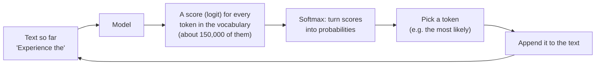
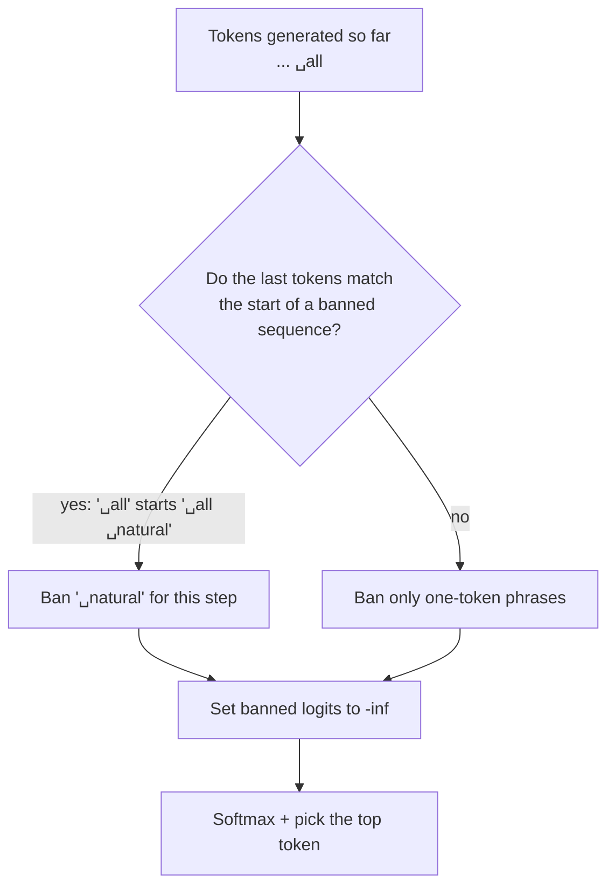
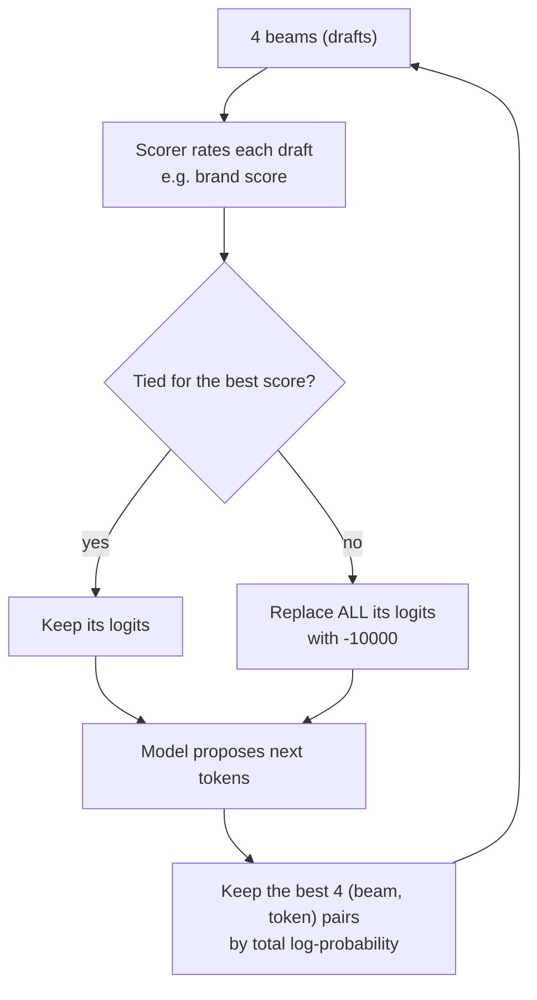
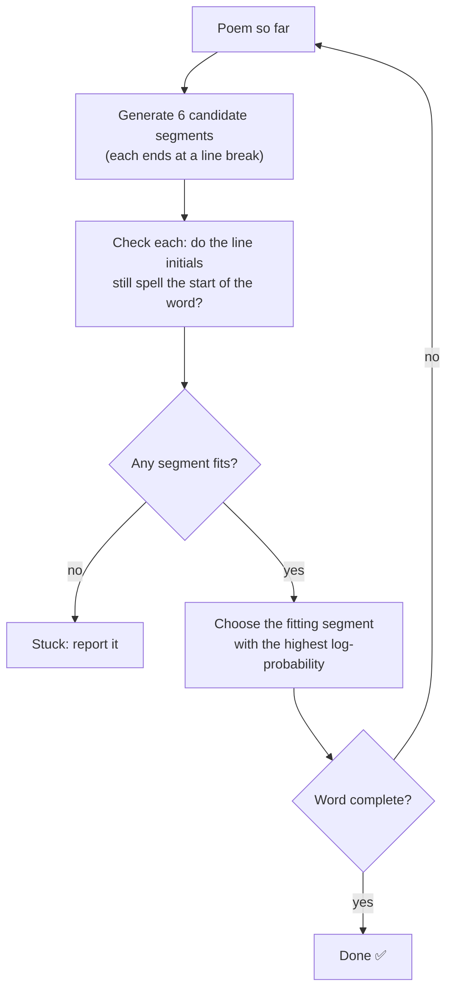
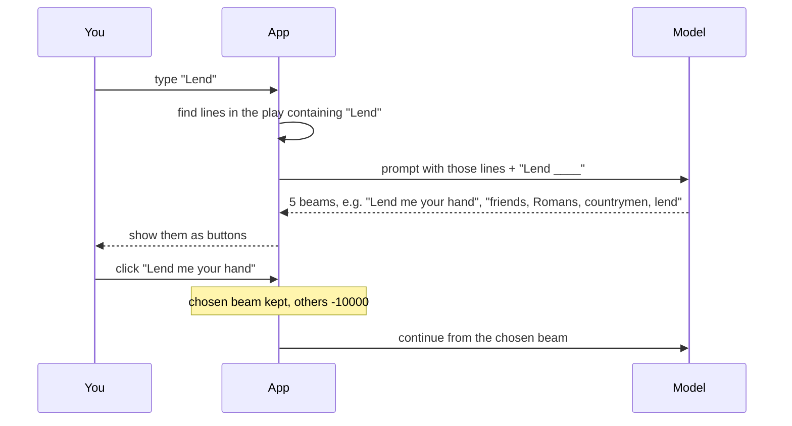
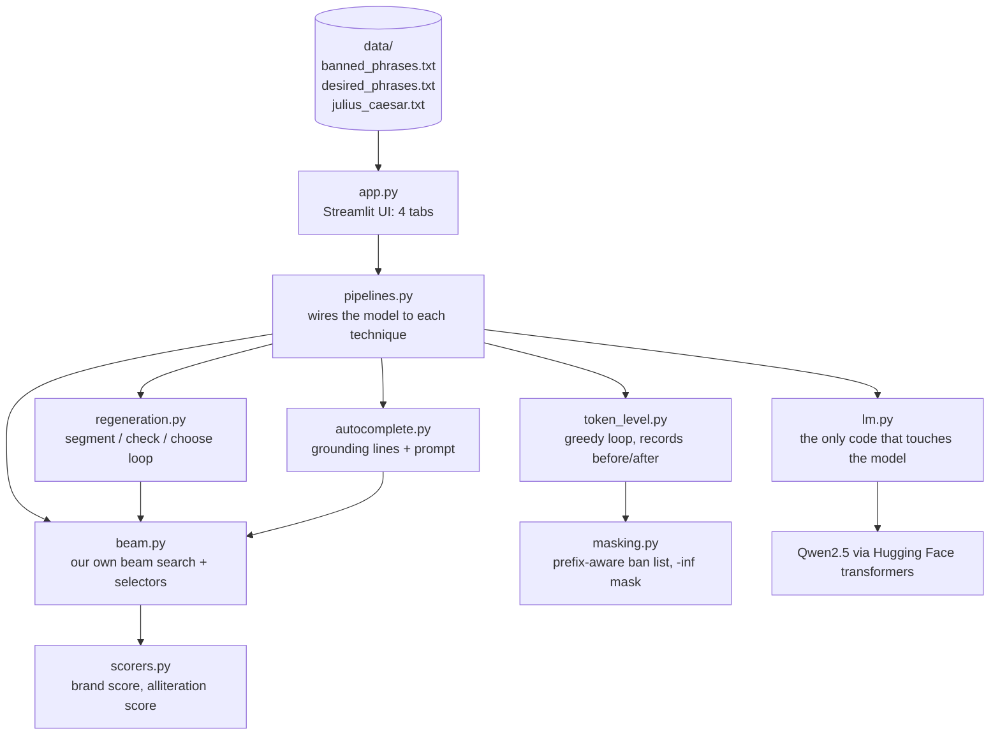

# How Logits Masking Works: a Beginner's Guide

This guide explains **logits masking** from the ground up and walks through every part of the
Logits Masking Explorer app. No machine-learning background is needed. If a word is unfamiliar,
check the [glossary](../GLOSSARY.md).

> **The 30-second version.** A language model writes one small piece of text (a *token*) at a time.
> Before choosing each token it gives every possible token a score. **Logits masking** means
> editing those scores *before* the choice is made, so that tokens (or whole drafts) we don't want
> can never be picked. The model still does the writing; we just take some options off the table.

---

## 1. How a language model picks the next word

A language model doesn't write sentences in one go. It runs a loop:

- A **token** is a chunk of text: often a whole word with its leading space (`␣power`), sometimes a
  piece of a word (`Ult` + `imate`), sometimes punctuation or a line break.
- **Logits** are the model's raw scores, one per token. Higher means "I think this fits better".
  They can be any number, negative or positive.
- **Softmax** turns logits into **probabilities** that add up to 100%. A token whose logit is
  −∞ (minus infinity) gets a probability of exactly 0%.
- **Greedy decoding** simply picks the most probable token each time.

That last point is the whole trick: **if you can change the logits, you can control what the model
is allowed to say.**

---

## 2. Token-level masking (tab ①)

### The idea

Before the model picks a token, we find the tokens we don't want and set their logits to −∞.
Their probability drops to 0, and the probabilities of everything else are scaled up so they
still add up to 100% (that's called *renormalising*).

### A real example from the app

The app asks the model (Qwen2.5-0.5B) to write a product description for a "protein drink", with a
list of phrases Amazon restricts in listings ("ultimate", "perfect", "natural", …). After writing
`Experience the`, here is what the model wanted next:

| Token | Before masking | Banned? | After masking |
|---|---|---|---|
| `␣ultimate` | 25.0% | 🚫 yes | 0% |
| `␣perfect` | 18.3% | 🚫 yes | 0% |
| `␣power` | 14.0% | | **26.4%** ← picked |
| `␣energy` | 4.4% | | 8.4% |
| `␣boost` | under 3.1% | | 4.9% |

Without the mask the model would have written "Experience the **ultimate** …". With it, it wrote
"Experience the **power** of protein…". The finished unmasked description contained five banned
phrases ("natural", "perfect", "perfect for", "quality", "ultimate"); the masked one contained none.

### The catch: phrases are made of several tokens

You can't just ban "the token for *all natural*", because there isn't one:

| Phrase as written | Tokens |
|---|---|
| `all natural` | `all` · `␣natural` |
| ` All natural` | `␣All` · `␣natural` |
| `Ultimate` | `Ult` · `imate` |
| ` ultimate` | `␣ultimate` |

Two things to notice: the **same words split differently** depending on capital letters and a
leading space, and one phrase can be **several tokens long**.

So the app does **prefix-aware** masking:

1. For each banned phrase, list its spelling variants (lowercase, Capitalised, Title Case, UPPER,
   each with and without a leading space) and tokenize each one.
2. At every step, look at the last few tokens generated so far.
3. If they match the beginning of a banned token sequence, ban the token that would **finish** it.
   One-token phrases are banned everywhere.

Banning `␣natural` *only right after* `␣all` keeps the mask narrow, so "natural" isn't blocked
everywhere unless it's banned by itself (in this list it is).

**Limitation:** the model could still spell a phrase in a way we didn't list (for example
`nat` + `ural`). Token masking only blocks the token sequences you give it.

---

## 3. Sequence selection (tab ②)

### From one draft to several: beam search

Instead of keeping one draft, **beam search** keeps several drafts alive at the same time. Each
draft is called a **beam**. At each step every beam proposes its best next tokens, and the overall
best few (by total probability) become the new beams.

### The idea

**Sequence selection** adds a judge. At every step, a **scorer** reads each beam's text so far.
Beams tied for the best score survive; every other beam gets **all** of its logits replaced with
`-10000`. A beam with logits like that can't win a place in the next round, so only the survivors'
continuations go forward.

> Why `-10000` and not −∞? The reference notebooks use `-10000` because some PyTorch operations
> misbehave with infinity. It's so low that it acts like −∞.

### A real example from the app

Scorer: **brand score** = (desired phrases present) − (banned phrases present).

| Step | Beam text so far | Score | Status |
|---|---|---|---|
| 3 | `Boost your energy` | 0 | ✅ survives |
| 3 | `Experience the ultimate` | −1 | 🚫 masked |
| 3 | `Discover the ultimate` | −1 | 🚫 masked |
| 3 | `Experience the perfect` | −1 | 🚫 masked |

The three beams that used a banned word are cut off. All four beams at the next step grow out of
"Boost your energy".

### Two scorers, one mechanism

The app also offers notebook 1's **alliteration score** (count words starting with a letter).
Same beam loop, different judge. Try it with "donkey": the selected output may collapse into
"Donkey donkey donkey…". That's the scorer being **gamed**: the selector rewards *only* the
score. Masking enforces a goal; it doesn't understand quality. The notebook counters this by also
asking for readability in the prompt.

---

## 4. Sequence regeneration (tab ③)

### The idea

Some rules can only be checked on a chunk of text, not on a single token. Example: an
**acrostic poem**, where the first letters of the lines spell a word (B-O-L-D). So instead of
masking every step:

1. Generate a few short **segments** (here: candidate next lines).
2. Throw away every segment that breaks the rule.
3. Keep the **most probable** segment that still fits, and continue from there.

**Log-probability** is how likely the model thinks a whole segment is. It's a negative number;
closer to 0 means more likely.

### A real example from the app (target WILD, animal tiger)

| Round | Chosen line | Initials |
|---|---|---|
| 1 | Wild, the tiger roars, | W |
| 2 | In the forest's embrace, | WI |
| 3 | Lions watch, | WIL |
| 4 | Dogs bark, | WILD ✅ |

Not great poetry from a 0.5B model, but every line passed the check. When **no** segment fits, the
technique is stuck: it can only choose among what the model offers. That's its real limitation.

**Masking or not?** Nothing is set to −∞ here. Rejecting a whole segment is the same idea
("this continuation is not allowed") applied after the fact, to a chunk instead of a token.

---

## 5. Autocomplete (tab ④)

### The idea

Same as sequence selection, but **you** are the selector. You type a few words; the model, given
lines from *Julius Caesar* that contain them, offers several beams. Clicking one keeps that beam
and is equivalent to setting every other beam's logits to `-10000`.

The notebook picked one beam **per token** (at random, to simulate a person). The app lets you
pick per **chunk** of about 8 tokens, which feels like real autocomplete and uses the same idea.

---

## 6. How the app is built

**Design choices worth knowing:**

- **`lm.py` is the only place that talks to the model.** Every other module works on plain token ids
  and numbers, so it can be tested with tiny fake models (see `tests/`).
- **Beam search is hand-written** ([ADR 0001](adr/0001-custom-beam-search.md)). The library's
  built-in beam search hides which beams existed at each step; ours records it so you can see it.
- **KV cache.** To stay fast on a laptop, the model remembers its work on earlier tokens instead of
  re-reading the whole text every step. In beam search the cache is reshuffled to follow each beam's
  parent.

---

## 7. The three techniques side by side

| | Token-level masking | Sequence selection | Sequence regeneration |
|---|---|---|---|
| What gets blocked | Individual tokens | Whole beams (drafts) | Whole segments |
| When | Every step, before choosing | Every step, before choosing | After a segment is written |
| Rule must be checkable on… | the next token | the text so far | a finished chunk |
| Guarantee | Listed token sequences never appear | Survivors always have the best score | Every kept segment passes the check |
| Failure mode | Misses unlisted spellings | Scorer gets gamed | Gets stuck if nothing fits |
| In the app | Tab ① | Tabs ② and ④ | Tab ③ |

---

## 8. Where the app differs from the notebooks

| Notebook | The app | Why |
|---|---|---|
| Llama 3.2 3B on a GPU | Qwen2.5 0.5B / 1.5B on a laptop CPU | Runs on 8 GB RAM, no access token needed |
| Beam *sampling* (`do_sample=True`) | Deterministic beam search | Same result every run, easier to study |
| Phrases matched as plain substrings | Whole-word matching | Substring matching counts "add" inside "address" |
| Regeneration segments of 16 tokens | Segments end at a line break | A 16-token segment often spans two lines and fails on the second |
| LLM picks the target word and a seed line | You type the target word | The extra steps are prompt engineering, not the lesson |
| Regeneration prompt doesn't mention the next letter | Prompt hints the next letter | The small model rarely finds it otherwise; the check still enforces it |
| Autocomplete picks per token, at random | You pick per ~8-token chunk | Real autocomplete feel, same mechanism |
